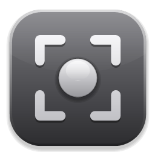
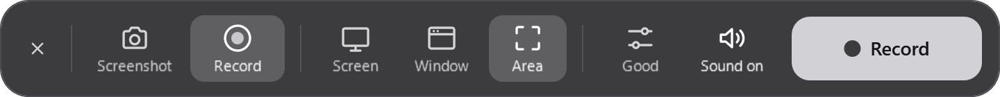
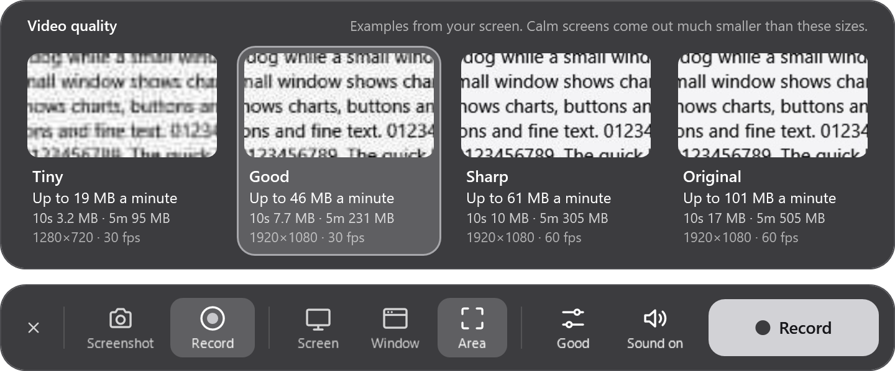
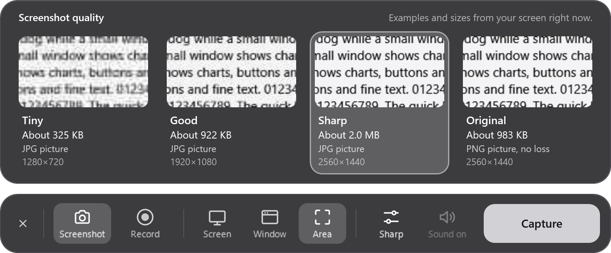
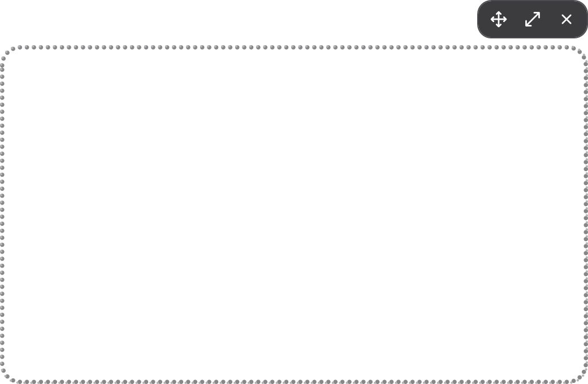
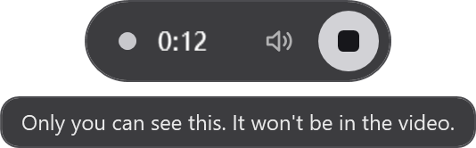
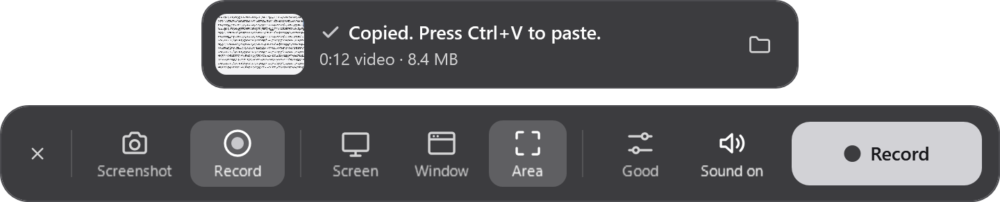
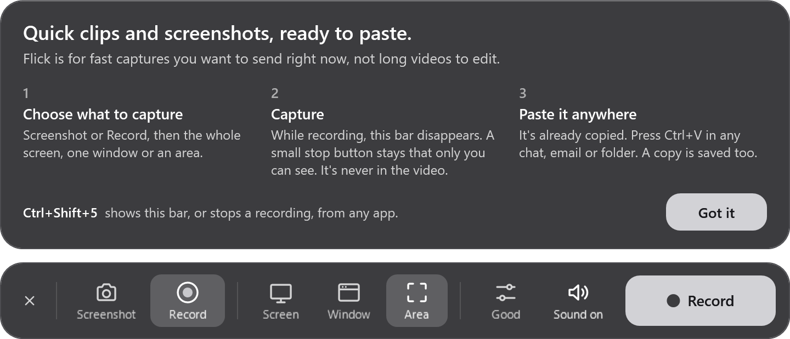

  

<h1 align="center">Flick</h1>

  Quick screen clips and screenshots for Windows, ready to paste. 
  Pick what to capture, press the button, then press Ctrl+V anywhere.

  <a href="https://github.com/fentdevelops/flick/releases/latest/download/Flick-standalone.exe"><b>Download for Windows</b></a>
  &nbsp;·&nbsp;
  <a href="https://github.com/fentdevelops/flick/releases/latest">All downloads</a>

  

Flick is a small bar that floats above your other apps. It's made for fast captures you want to send right now, not long videos to edit. Everything you capture lands on your clipboard by itself, and a copy is saved too.

## What it does

- **Screenshots and video:** capture the whole screen, one window, or an area you drag out.
- **Automatic copy:** when a capture finishes, press Ctrl+V in a chat, an email or a folder.
- **Out of the way while recording:** the bar disappears and a small stop button stays. Only you can see it. Windows keeps it out of the video.
- **Quality you can see:** four levels with examples made from your own screen, plus the file size each one gives.
- **Sound on or off:** record what your computer is playing, or nothing. Microphones aren't recorded.
- **Light:** the small build is a 2 MB exe. When idle it uses no CPU and about 120 MB of memory. Recording used under 1% CPU in testing, even on a 4K screen at 60 fps.

## A closer look

### Choose your quality

Each card shows what that level does to your own screen, and how big the file gets. Choosing one closes the strip until you click Quality again.

Screenshots show the size of the actual picture they'd save.

### Set the area, then adjust it

A dotted line marks the area. The small control at its top right moves it, even to another screen, resizes it, or removes it. Your capture itself is a normal rectangle.

### Stop when you're ready

While recording, this is all that's on screen, and it never appears in the video.

### Paste it

### First launch

A short guide explains the idea the first time you open Flick.

## Download

Requires Windows 10 version 2004 or newer, or Windows 11.

| File | Size | Use it if |
|---|---|---|
| [Flick-standalone.exe](https://github.com/fentdevelops/flick/releases/latest/download/Flick-standalone.exe) | 59 MB | You just want it to run. Nothing else to install. |
| [Flick.exe](https://github.com/fentdevelops/flick/releases/latest/download/Flick.exe) | 2 MB | You have the free [.NET 10 Desktop Runtime](https://dotnet.microsoft.com/download/dotnet/10.0), or don't mind installing it. |

There's no installer: download it and double-click it. The app isn't code-signed yet, so Windows may show a "Windows protected your PC" warning. Choose **More info**, then **Run anyway**.

## Using it

- **`Ctrl+Shift+5`** shows or hides the bar, and stops a recording, from any app.
- **The ✕ on the bar** hides it. To quit, right-click the tray icon.
- **Pasting:** screenshots paste as a picture or a file. Videos paste as a file, which works in chat apps, email and folders, but not in apps that only accept text or pictures.
- **Saved copies** are kept in `Videos\Flick` and `Pictures\Flick`. Flick never deletes them.
- **Start with Windows** is in the tray menu, and is off by default.

## Building

Double-click `build.bat`. It installs the .NET SDK if needed and writes `dist\Flick.exe`.

| Command | Result |
|---|---|
| `build.bat` | Small exe that needs the .NET 10 Desktop Runtime. |
| `build.bat standalone` | Bigger exe in `dist\standalone` that needs nothing installed. |

To change the app icon, edit and run `tools\make-icon.ps1`.

## How it works

| Part | File | Notes |
|---|---|---|
| Capture | `src/Wgc.cs` | Windows Graphics Capture through its COM vtables. The official C# wrapper adds 25 MB, so it isn't used. |
| Recording | `src/Recorder.cs` | GPU scaling and colour conversion, H.264 through Media Foundation (hardware, then software if that fails). Frames are written on a fixed clock, so the file plays steadily and sound can't drift. |
| Sound | `src/Loopback.cs` | WASAPI loopback. Windows sends nothing during silence, so silence is filled in by the clock. |
| Screenshots, clipboard | `src/Snap.cs` | |
| Interface | `src/Ui/` | WPF, flat grey. |

A settings file and a small log live in `%LOCALAPPDATA%\Flick`. Flick doesn't connect to the internet.

## Testing

These run from a built exe and write their results into the given folder.

| Command | What it does |
|---|---|
| `Flick.exe --selftest <folder>` | Records a test window at every level, reads each file back, then measures whole real screens for speed. Set `FLICK_SOFTWARE=1` to force the software encoder. |
| `Flick.exe --flow-test <folder>` | Drives the real bar and stop pill on screen, without taking focus. Proves they're missing from captures, and checks the clipboard. Puts your clipboard back afterward. Set `FLICK_DATA` to a scratch folder to leave your settings alone. |
| `Flick.exe --ui-shots <folder>` | Draws each UI state to a transparent PNG without showing anything. The pictures in this README come from it, using made-up content. |

## Good to know when changing the code

- An MP4 "fast start" option (`MF_MPEG4SINK_MOOV_BEFORE_MDAT`) was tried and removed: it corrupted files in a way only a strict player notices. WPF's player still opened them. Check clips in Chromium as well.
- WPF windows entirely off screen render black, so test windows sit on screen underneath everything else.
- Read and write source files as UTF-8. Windows PowerShell 5.1's `Get-Content` assumes ANSI and garbles `·` and `×`.

## License

[MIT](LICENSE)
